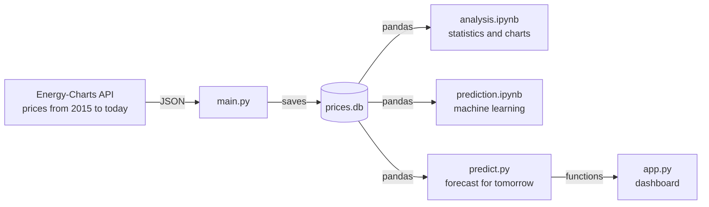
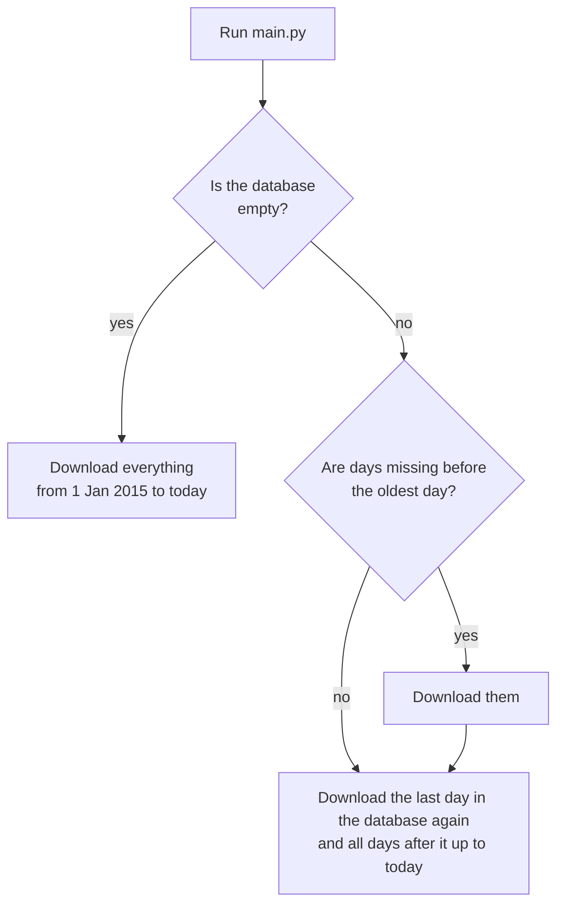

# Electricity prices in Slovakia

[Slovenčina](README.md) | **English**

A project that collects hourly electricity prices in Slovakia, stores them in a database, analyses them
and uses machine learning to forecast prices for the next day.

These are **day-ahead prices**: the price for every hour of tomorrow is set by the exchange one day in
advance. They are wholesale prices without VAT, distribution and other fees, so they are not what a
household pays on its bill. They do, however, show well when there is plenty of electricity in the grid
and when it is expensive.

The project has four parts:

- **Data collection** ([`main.py`](main.py)): on the first run it downloads the whole history since 2015
  from the API, and on later runs it only fills in the missing days up to today.
- **Analysis** ([`analysis.ipynb`](analysis.ipynb)): a Jupyter notebook with statistics and charts, for
  example how the price changed over the years, at which hour electricity is cheapest or how often the
  price is negative.
- **Prediction** ([`prediction.ipynb`](prediction.ipynb)): machine learning models that forecast the
  24 hourly prices for tomorrow, compared with the simple guess "tomorrow will be like today".
  The best model is then used by the [`predict.py`](predict.py) script, which prints the forecast with
  a single command.
- **Dashboard** ([`app.py`](app.py)): an interactive Streamlit web app with a period filter, key figures,
  charts and tomorrow's forecast.


> **The charts in this README are drawn from made-up data**, not from real prices. The reason is
> explained below.

## Why the charts are only illustrative

The historical data come from the [Energy-Charts](https://energy-charts.info) API, which provides them
for private and internal use only. Neither the raw data nor anything derived from them (charts, tables,
computed numbers) may be published. Therefore:

- the `prices.db` database is in [`.gitignore`](.gitignore),
- the notebook is committed without outputs, charts from real data only appear after you run it,
- the summary at the end of the notebook describes the findings in words only, without numbers,
- the charts in the README were drawn by the [`docs/example_charts.py`](docs/example_charts.py) script
  from random numbers. They only imitate typical shapes (daily cycle, weekends, seasons) to show what
  kind of charts the notebook draws. Every chart has a note under its title saying it does not show
  real prices.

The code is public. Whoever runs it downloads the data themselves for their own use.

## How it is built



The API takes its prices from the European ENTSO-E platform.

**Why there is no scraping here:** the project originally scraped today's prices from the
energyprices.eu website and took only the history from the API. In October 2026 the website shut down
without warning ("This site is no longer available"). The project survived it without an outage: the
failure of one source did not stop the script, and the API could already provide today as well.
I then removed the scraping, because when an API exists it is more stable than parsing the HTML of
a page that can change its layout or disappear at any time.

### Data collection

On every run, `main.py` finds out which days are missing from the database (`missing_ranges`),
downloads them from the API (`fetch_history`) and saves them (`save`). The `main` function just calls
these steps in order.

Which days get downloaded:



The first run takes two to three minutes. Later runs on the same day download only today, and after
a few skipped days only those days. The last day is downloaded again in case it was incomplete.

A few things that are not obvious at first glance:

- **An API outage does not crash the script.** When the API or the internet is down, the script reports
  it and the data already in the database stay. The missing days are downloaded on the next run.
- **The API must not be flooded.** It allows roughly one request per 15 seconds. That is why the script
  downloads whole years at a time (one request = one year). When the API answers
  `429 Too Many Requests`, it waits as long as the server says in the `Retry-After` header and tries again.
- **No duplicates in the database.** The date + hour pair is the primary key, and writing with
  `INSERT OR REPLACE` overwrites an existing row instead of adding a new one. So the script can be run
  as many times as you like.
- **An incomplete download leaves no gaps.** The whole history is saved at once in a single transaction.
  If the download fails, nothing is saved and everything is downloaded again on the next run.
- **Since October 2025 prices are per 15 minutes.** The API then returns four prices per hour and the
  script averages them per hour, so all data have the same shape.
- **Units.** The API returns €/MWh, the script converts them to €/kWh, the unit prices are usually
  quoted in.
- **Time.** The API sends time as a Unix timestamp and the script converts it to the computer's local
  time. In Slovakia (CET/CEST) this is correct. On a computer in a different time zone the hours would
  be shifted.

### Database

One table in the `prices.db` file (SQLite, no server to install):

| Table | Columns |
|---|---|
| `prices` | `date` (text, `2026-10-20`), `hour` (0 – 23), `price` (€/kWh); the `date` + `hour` pair is the primary key |

### Analysis

The notebook reads the data directly from the database with `pd.read_sql`, and each section has a short
explanation of what it does and which pandas command it uses.

| # | Section | What it shows |
|---|---|---|
| 1 | Loading the data | `read_sql`, time index, helper columns (year, month, day of week) |
| 2 | Data check | `describe()`, missing days, most expensive and cheapest hours |
| 3 | Price distribution | histogram, mean vs. median, standard deviation, skewness, percentiles |
| 4 | Outliers | boxplot by month, IQR rule, z-score |
| 5 | Development 2015 – 2026 | monthly averages with `resample` |
| 6 | Moving averages | 30-day and 365-day averages, band of mean ± 2 standard deviations |
| 7 | Time series decomposition | price = trend + seasonality + residual, computed by hand in pandas |
| 8 | Daily profile | average price by hour in selected years |
| 9 | Weekday vs. weekend | average price by hour |
| 10 | Hour × month | heatmap |
| 11 | Negative prices | number of hours with a negative price per year |
| 12 | Daily spread | difference between the most expensive and the cheapest hour of the day |
| 13 | Regression and autocorrelation | today's price vs. yesterday's, regression line, R², autocorrelation |

Example charts (made-up data, same chart type as in the notebook):

| Daily profile (section 8) | Hour × month (section 10) |
|---|---|
|  |  |


Main findings from the real data (in words, the notebook shows the exact numbers after you run it):

- The 2021 – 2022 energy crisis is clearly visible in the data. Prices dropped afterwards but stayed
  higher than before the crisis.
- In recent years the cheapest hour of the day has moved **from the night to midday**, because solar
  power plants produce a lot during the day. The evening is still the most expensive.
- Weekends are cheaper than weekdays, most of all at midday.
- The number of hours with a negative price has risen sharply in recent years.
- The price is strongly related to the price an hour ago, a day ago and a week ago, which is a good
  basis for prediction.

### Prediction

The task: this morning, before tomorrow's prices are published (around 13:00), forecast the 24 hourly
prices for tomorrow. The model may only use what is known at that moment, i.e. prices up to and
including today.

| Step | What is done |
|---|---|
| Inputs | hour, day of week, month, weekend, price at the same hour 1, 2 and 7 days earlier, average of the previous day and week |
| Data split | by time, not randomly: training 2023 – 2024, validation 2025, test 2026 |
| Baseline | "tomorrow = today" and "tomorrow = a week ago", every model has to beat them |
| Models | linear regression (with one-hot encoding and scaling in a `Pipeline`), Random Forest, gradient boosting (scikit-learn) |
| Evaluation | MAE and RMSE, errors by hour and month, feature importance (`permutation_importance`) |
| Final test | the best model is evaluated once on 2026, which it never saw during development |
| Output | forecast for tomorrow and the cheapest 4 consecutive hours (e.g. for charging an electric car) |

Results in words: all models beat the baseline, the differences between them are small. The most
important input is yesterday's price at the same hour. The largest errors are during the day and at the
evening peak; sharp spikes cannot be predicted from past prices.

## Getting started

You need [Python](https://www.python.org/downloads/) 3.12 or newer and [Git](https://git-scm.com/).
For the notebook I recommend [VS Code](https://code.visualstudio.com/) with the Jupyter extension.

### 1. Clone the project

```bash
git clone https://github.com/Matus1232/Script-for-electricity-prices-with-prediction.git
```

Run the following commands in the project folder (`cd Script-for-electricity-prices-with-prediction`).

### 2. Install the libraries

```bash
pip install -r requirements.txt
```

The exact versions are in [`requirements.txt`](requirements.txt):

| Library | What it is for |
|---|---|
| `requests` | calling the API |
| `pandas`, `numpy` | working with data and calculations in the notebook |
| `matplotlib` | charts |
| `ipykernel` | so VS Code can run the notebook |
| `scikit-learn` | machine learning models and metrics |
| `joblib` | saving the trained model to a file |
| `streamlit` | dashboard (its charts are drawn by Altair, which is installed with Streamlit) |

### 3. Download the data

```bash
python main.py
```

The script prints today's prices by hour and then the progress of downloading the history year by year.
At the end a `prices.db` file appears in the folder. To keep the database up to date, run the script
once a day.

### 4. Run the analysis

Open `analysis.ipynb` in VS Code, pick a Python kernel with the libraries installed in the top right
corner and click **Run All**. If `prices.db` does not exist yet, a cell in section 1 stops with an error
telling you to run `main.py` first.

Run `prediction.ipynb` the same way.

### 5. Forecast for tomorrow

```bash
python predict.py
```

The script prints prices for the 24 hours of the day after the last day in the database and the cheapest
4 consecutive hours. On the first run it trains the model (gradient boosting, the same as in the
notebook) and saves it to `models/model.joblib`; later runs just load it. When the model is older than
7 days, it retrains itself on the latest data.

**Tracking accuracy (monitoring).** Every forecast is saved to the `forecasts` table in `prices.db`.
When `main.py` downloads the actual prices the next day, `predict.py` first prints on its next run how
well the forecast did (model MAE vs. the "tomorrow = today" baseline), and only then forecasts the next
day.

| Command | What it does |
|---|---|
| `python predict.py` | forecast with the saved model |
| `python predict.py --train` | retrains the model on the latest data |
| `python predict.py --hours 6` | cheapest 6 consecutive hours instead of 4 |

The model is trained on Energy-Charts data, so it is in `.gitignore` as well.

### Running automatically every day

[`run_daily.bat`](run_daily.bat) runs `main.py` and then `predict.py` and appends everything they print
to `logs/daily.log`. On Windows you just schedule it in Task Scheduler, for example every day at 8:00.
The forecast makes sense in the morning, before tomorrow's prices are published around 13:00. You can
also schedule it with a PowerShell command (run it in the project folder):

```powershell
$action = New-ScheduledTaskAction -Execute "$PWD\run_daily.bat"
$trigger = New-ScheduledTaskTrigger -Daily -At 8:00
$settings = New-ScheduledTaskSettingsSet -StartWhenAvailable -AllowStartIfOnBatteries -DontStopIfGoingOnBatteries
Register-ScheduledTask -TaskName "Ceny elektriny" -Action $action -Trigger $trigger -Settings $settings
```

`-StartWhenAvailable` means that if the computer is off at 8:00, the task runs right after it is turned
on. Without `-AllowStartIfOnBatteries`, Windows would not start the task on a laptop running on battery;
it would just wait in the queue (state "Queued").
You remove it with `Unregister-ScheduledTask -TaskName "Ceny elektriny"`.

### 6. Dashboard

```bash
python -m streamlit run app.py
```

`http://localhost:8501` opens in the browser. On the left you choose the period and the length of the
charging window, at the top are the key figures for the period (average, cheapest and most expensive
hour, number of negative hours), and below them five tabs (the app's interface is in Slovak):

| Tab | What it shows |
|---|---|
| Forecast for tomorrow | 24 forecast prices, the cheapest window in orange |
| Forecast accuracy | saved forecasts vs. actual prices, model and baseline MAE by day |
| Price development | daily prices as dots and the 30-day moving average as a line |
| Daily profile | average price by hour, weekday vs. weekend |
| Hour × month | heatmap |

Hovering over a chart shows the exact value. The forecast uses the functions and the saved model from
`predict.py`.

**Demo mode:** `python -m streamlit run app.py -- --demo` (or when `prices.db` does not exist) shows
made-up data with a warning at the top. The model is then trained only in memory and does not overwrite
the saved model. This mode can be shown publicly; the real data only locally.

> ⚠️ Before committing, run **Clear All Outputs** in the notebook. VS Code saves charts and tables
> directly into the notebook file and those must not get to GitHub.

## Tests

The tests in the [`tests/`](tests) folder need neither the database nor the internet. API responses are
replaced by fake ones and the prices are made up, so every value can be checked exactly.

| File | What it checks |
|---|---|
| `test_main.py` | API outage, averaging 15-minute prices and converting €/MWh → €/kWh, waiting after `429`, downloading by year, choosing missing days, writing without duplicates |
| `test_predict.py` | lags and daily averages without data leakage, forecast for the day after the last day, stopping when days are missing, cheapest window, saving and evaluating a forecast |

Running them (the development libraries are in `requirements-dev.txt`):

```bash
pip install -r requirements-dev.txt
```

```bash
python -m pytest
```

```bash
python -m ruff check .
```

GitHub Actions ([`.github/workflows/ci.yml`](.github/workflows/ci.yml)) installs the libraries, checks
the code (`ruff`) and runs the tests on every push to `main` and on every pull request.

## Known limitations

- **A few days are missing in the source** from 2015 – 2016. In the notebook they are filled in by
  `interpolate()` for the moving averages; otherwise they stay empty.
- **Daylight saving time.** The last Sunday in March has only 23 hours. In October the 2:00 hour occurs
  twice and the database stores their average.

## Project structure

```
main.py           data collection from the API, writing to the database
analysis.ipynb    analysis: statistics and charts
prediction.ipynb  prediction: machine learning
predict.py        forecast for tomorrow with one command, saves the model to models/ (not in Git)
app.py            Streamlit dashboard, with real or made-up data
run_daily.bat     daily run of main.py and predict.py, output to logs/ (not in Git)
tests/            tests for main.py and predict.py (pytest)
.github/          GitHub Actions: code check and tests on every push
pyproject.toml    pytest and ruff settings
requirements-dev.txt  development-only libraries (pytest, ruff)
requirements.txt  libraries with exact versions
docs/             illustrative charts for the README and the script that draws them from made-up data
.gitignore        data that must not be published
prices.db         SQLite database, created after running main.py (not in Git)
```

## Project status

- [x] ~~Scraping today's prices from the website~~ (the website shut down in October 2026, replaced by the API)
- [x] SQLite database and history since 2015 from the API
- [x] Analysis: descriptive statistics, time series, regression
- [x] `requirements.txt`
- [x] Refactoring `main.py` into functions
- [x] Next-day price prediction (baseline, linear regression, Random Forest, gradient boosting)
- [x] `predict.py` script with a saved model
- [x] Streamlit dashboard with demo mode
- [x] Saving forecasts and tracking their accuracy
- [x] Daily runs via Task Scheduler
- [x] Tests (pytest) and GitHub Actions
- [ ] More inputs: holidays, weather forecast and solar and wind production
- [ ] Deep learning experiment (MLP, LSTM)
