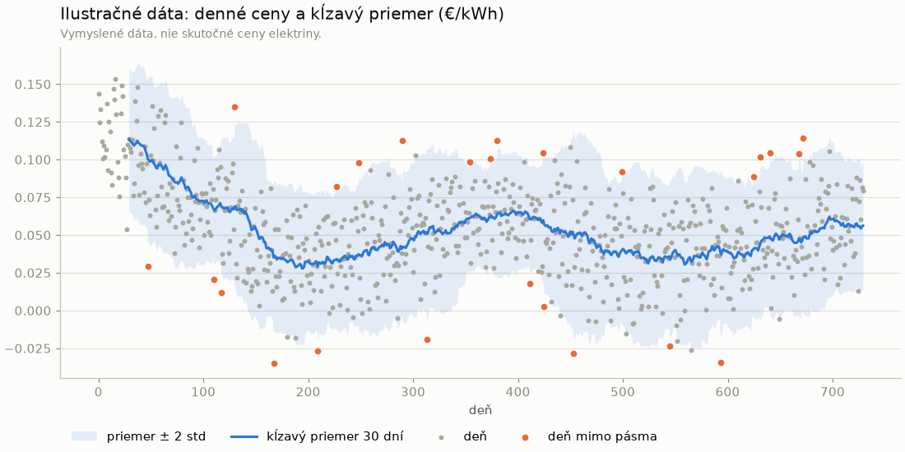
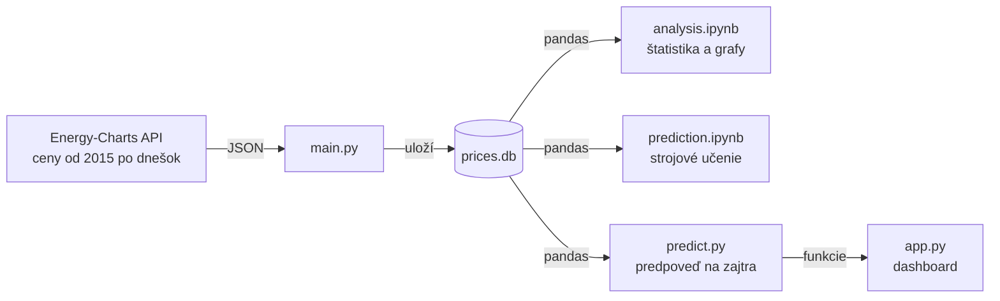
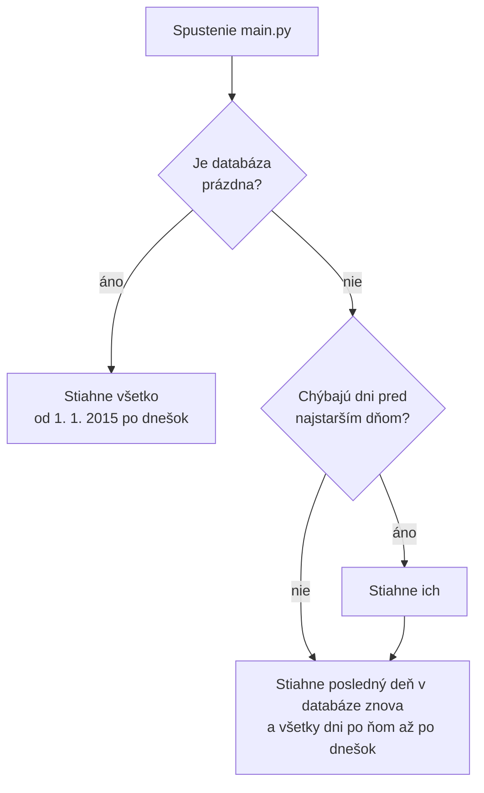
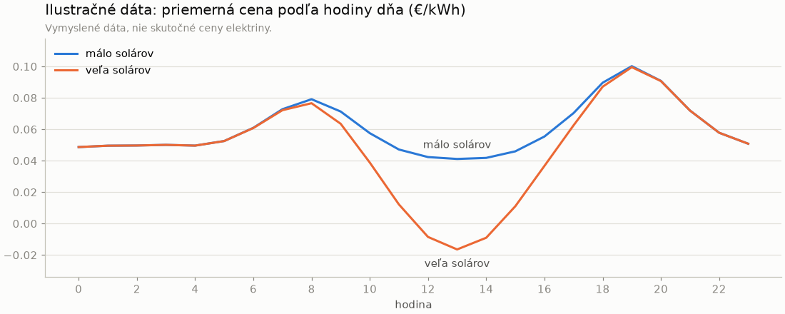
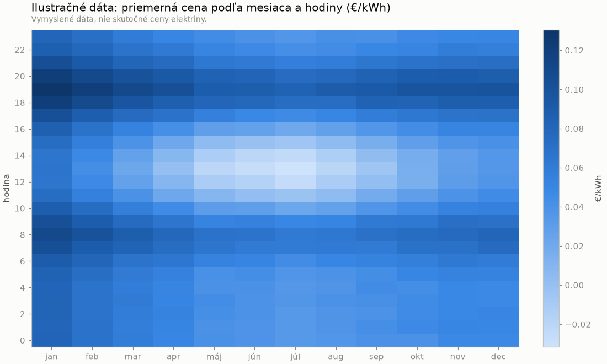
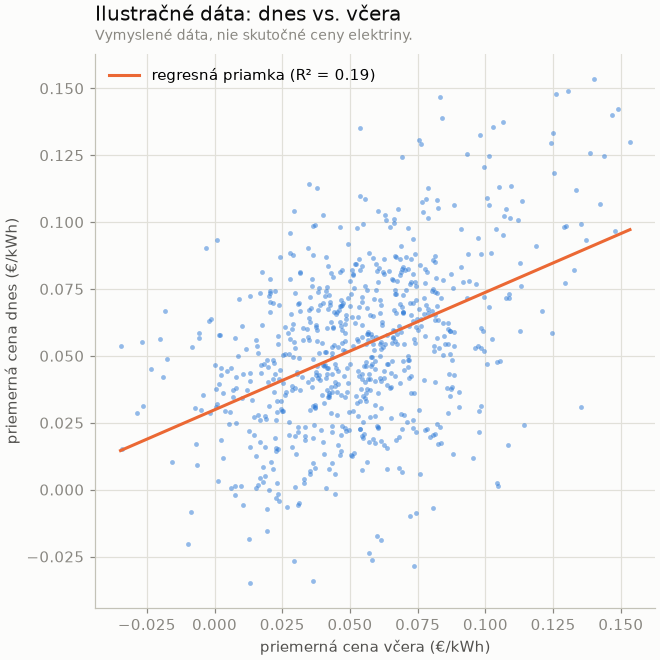

# Ceny elektriny na Slovensku

Projekt, ktorý zbiera hodinové ceny elektriny na Slovensku, ukladá ich do databázy, analyzuje ich
a pomocou strojového učenia predpovedá ceny na ďalší deň.

Ide o **day-ahead ceny**: cenu na každú hodinu zajtrajška určí burza vždy deň vopred. Sú to
veľkoobchodné ceny bez DPH, distribúcie a ďalších poplatkov, takže nie sú to isté, čo platí domácnosť
na faktúre. Dobre však ukazujú, kedy je elektriny v sieti dosť a kedy je drahá.

Projekt má štyri časti:

- **Zber dát** ([`main.py`](main.py)): pri prvom spustení stiahne z API celú históriu od roku 2015
  a pri ďalších spusteniach doplní len dni, ktoré chýbajú, až po dnešok.
- **Analýza** ([`analysis.ipynb`](analysis.ipynb)): Jupyter notebook so štatistikou a grafmi, napríklad
  ako sa cena menila počas rokov, v ktorú hodinu je elektrina najlacnejšia alebo ako často je cena záporná.
- **Predikcia** ([`prediction.ipynb`](prediction.ipynb)): modely strojového učenia, ktoré predpovedajú
  24 hodinových cien na zajtra, porovnané s jednoduchým odhadom „zajtra bude ako dnes“.
  Najlepší model potom používa skript [`predict.py`](predict.py), ktorý predpoveď vypíše jedným príkazom.
- **Dashboard** ([`app.py`](app.py)): interaktívna webová aplikácia v Streamlite s filtrom obdobia,
  hlavnými číslami, grafmi a predpoveďou na zajtra.



> **Grafy v tomto README sú z vymyslených dát**, nie zo skutočných cien. Prečo, je vysvetlené nižšie.

## Prečo sú grafy len ilustračné

Historické dáta pochádzajú z API [Energy-Charts](https://energy-charts.info), ktoré ich poskytuje len
na súkromné a interné použitie. Zverejniť sa nesmú ani surové dáta, ani nič, čo z nich vznikne
(grafy, tabuľky, vypočítané čísla). Preto:

- databáza `prices.db` je v [`.gitignore`](.gitignore),
- notebook je v repozitári bez výstupov, grafy zo skutočných dát sa zobrazia až po jeho spustení,
- zhrnutie na konci notebooku popisuje zistenia len slovne, bez čísel,
- grafy v README nakreslil skript [`docs/example_charts.py`](docs/example_charts.py) z náhodných čísel.
  Tie len napodobňujú typické tvary (denný cyklus, víkendy, ročné obdobia), aby bolo vidno, aké grafy
  notebook kreslí. Každý graf má pod nadpisom poznámku, že nejde o skutočné ceny.

Kód je verejný. Kto ho spustí, stiahne si dáta sám pre vlastnú potrebu.

## Ako je to postavené



API má ceny z európskej platformy ENTSO-E.

**Prečo tu nie je scraping:** projekt pôvodne scrapoval dnešné ceny z webu energyprices.eu
a z API bral len históriu. V októbri 2026 web bez varovania skončil („This site is no longer available“).
Projekt to ustál bez výpadku: výpadok jedného zdroja skript nezastavil a API už vtedy vedelo aj
dnešok. Scraping som potom odstránil, lebo keď existuje API, je stabilnejšie ako čítanie HTML
stránky, ktorá môže kedykoľvek zmeniť vzhľad alebo skončiť.

### Zber dát

`main.py` pri každom spustení zistí, ktoré dni v databáze chýbajú (`missing_ranges`), stiahne ich
z API (`fetch_history`) a uloží (`save`). Funkcia `main` tieto kroky len zavolá v poradí.

Ktoré dni sa sťahujú:



Prvé spustenie trvá dve až tri minúty. Ďalšie spustenia v ten istý deň stiahnu len dnešok
a po pár vynechaných dňoch len tie dni. Posledný deň sa sťahuje znova pre prípad, že nebol úplný.

Pár vecí, ktoré nie sú na prvý pohľad vidieť:

- **Výpadok API nezhodí skript.** Keď API alebo internet nefunguje, skript to vypíše a dáta, ktoré
  už sú v databáze, ostanú. Chýbajúce dni stiahne pri ďalšom spustení.
- **API sa nesmie zahltiť.** Pustí približne jednu požiadavku za 15 sekúnd. Skript preto sťahuje
  po celých rokoch (jedna požiadavka = jeden rok). Keď API odpovie `429 Too Many Requests`,
  počká toľko, koľko server povie v hlavičke `Retry-After`, a skúsi to znova.
- **Žiadne duplikáty v databáze.** Dvojica dátum + hodina je primárny kľúč a zápis cez
  `INSERT OR REPLACE` existujúci riadok prepíše namiesto pridania nového. Skript sa preto dá
  spustiť koľkokrát chceš.
- **Neúplné sťahovanie nenechá diery.** Celá história sa uloží naraz v jednej transakcii. Keď
  sťahovanie spadne, neuloží sa nič a pri ďalšom spustení sa stiahne celé znova.
- **Od októbra 2025 sú ceny po 15 minútach.** API vtedy vracia štyri ceny na hodinu, skript z nich
  spraví hodinový priemer, aby boli všetky dáta v rovnakom tvare.
- **Jednotky.** API vracia €/MWh, skript ich prepočíta na €/kWh, v ktorých sa ceny bežne uvádzajú.
- **Čas.** API posiela čas ako unixový timestamp a skript ho prevedie na miestny čas počítača.
  Na Slovensku (SEČ/SELČ) je to správne. Na počítači v inom časovom pásme by sa hodiny posunuli.

### Databáza

Jedna tabuľka v súbore `prices.db` (SQLite, netreba inštalovať žiadny server):

| Tabuľka | Stĺpce |
|---|---|
| `prices` | `date` (text, `2026-10-20`), `hour` (0 – 23), `price` (€/kWh); dvojica `date` + `hour` je primárny kľúč |

### Analýza

Notebook číta dáta priamo z databázy cez `pd.read_sql` a každá sekcia má krátke vysvetlenie,
čo robí a aký príkaz z pandas používa.

| # | Sekcia | Čo ukáže |
|---|---|---|
| 1 | Načítanie dát | `read_sql`, časový index, pomocné stĺpce (rok, mesiac, deň v týždni) |
| 2 | Kontrola dát | `describe()`, chýbajúce dni, najdrahšie a najlacnejšie hodiny |
| 3 | Rozdelenie cien | histogram, priemer vs. medián, smerodajná odchýlka, šikmosť, percentily |
| 4 | Odľahlé hodnoty | boxplot podľa mesiacov, pravidlo IQR, z-skóre |
| 5 | Vývoj 2015 – 2026 | mesačné priemery cez `resample` |
| 6 | Kĺzavé priemery | priemer za 30 a 365 dní, pásmo priemer ± 2 smerodajné odchýlky |
| 7 | Rozklad časového radu | cena = trend + sezónnosť + zvyšok, spočítané ručne v pandas |
| 8 | Priebeh dňa | priemerná cena podľa hodiny vo vybraných rokoch |
| 9 | Pracovný deň vs. víkend | priemerná cena podľa hodiny |
| 10 | Hodina × mesiac | heatmapa |
| 11 | Záporné ceny | počet hodín so zápornou cenou za rok |
| 12 | Kolísanie počas dňa | rozdiel medzi najdrahšou a najlacnejšou hodinou dňa |
| 13 | Regresia a autokorelácia | dnešná cena vs. včerajšia, regresná priamka, R², autokorelácia |

Ukážky grafov (vymyslené dáta, rovnaký typ grafu ako v notebooku):

| Priebeh dňa (sekcia 8) | Hodina × mesiac (sekcia 10) |
|---|---|
|  |  |



Hlavné zistenia zo skutočných dát (slovne, presné čísla ukáže notebook po spustení):

- Energetická kríza v rokoch 2021 – 2022 je v dátach jasne vidieť. Ceny potom klesli, ale zostali
  vyššie ako pred krízou.
- Najlacnejšia hodina dňa sa za posledné roky presunula **z noci na obed**, lebo cez deň vyrábajú
  veľa solárne elektrárne. Najdrahšie je stále večer.
- Víkend je lacnejší ako pracovný deň, najviac na obed.
- Hodín so zápornou cenou v posledných rokoch výrazne pribudlo.
- Cena silno súvisí s cenou pred hodinou, pred dňom aj pred týždňom, čo je dobrý základ pre predikciu.

### Predikcia

Úloha: dnes ráno, ešte pred zverejnením zajtrajších cien (okolo 13:00), predpovedať 24 hodinových cien
na zajtra. Model smie použiť len to, čo je v tej chvíli známe, teda ceny do dneška vrátane.

| Krok | Čo sa robí |
|---|---|
| Vstupy | hodina, deň v týždni, mesiac, víkend, cena v tú istú hodinu pred 1, 2 a 7 dňami, priemer predchádzajúceho dňa a týždňa |
| Rozdelenie dát | podľa času, nie náhodne: trénovanie 2023 – 2024, validácia 2025, test 2026 |
| Baseline | „zajtra = dnes“ a „zajtra = pred týždňom“, každý model ich musí poraziť |
| Modely | lineárna regresia (s one-hot a škálovaním v `Pipeline`), Random Forest, gradient boosting (scikit-learn) |
| Vyhodnotenie | MAE a RMSE, chyby podľa hodiny a mesiaca, dôležitosť vstupov (`permutation_importance`) |
| Finálny test | najlepší model sa raz vyhodnotí na roku 2026, ktorý pri vývoji nevidel |
| Výstup | predpoveď na zajtra a najlacnejšie 4 hodiny za sebou (napr. na nabíjanie elektromobilu) |

Výsledky slovne: všetky modely sú lepšie ako baseline, rozdiely medzi nimi sú malé. Najdôležitejší vstup
je včerajšia cena v tú istú hodinu. Najväčšie chyby sú cez deň a pri večernej špičke, prudké výkyvy
sa z minulých cien predpovedať nedajú.

## Spustenie

Potrebuješ [Python](https://www.python.org/downloads/) 3.12 alebo novší a [Git](https://git-scm.com/).
Na notebook odporúčam [VS Code](https://code.visualstudio.com/) s rozšírením Jupyter.

### 1. Stiahni projekt

```bash
git clone https://github.com/Matus1232/Script-for-electricity-prices-with-prediction.git
```

Ďalšie príkazy spúšťaj v priečinku projektu (`cd Script-for-electricity-prices-with-prediction`).

### 2. Nainštaluj knižnice

```bash
pip install -r requirements.txt
```

Presné verzie sú v [`requirements.txt`](requirements.txt):

| Knižnica | Načo je |
|---|---|
| `requests` | volanie API |
| `pandas`, `numpy` | práca s dátami a výpočty v notebooku |
| `matplotlib` | grafy |
| `ipykernel` | aby VS Code vedel spúšťať notebook |
| `scikit-learn` | modely strojového učenia a metriky |
| `joblib` | uloženie natrénovaného modelu do súboru |
| `streamlit` | dashboard (grafy v ňom kreslí Altair, ktorý sa nainštaluje so Streamlitom) |

### 3. Stiahni dáta

```bash
python main.py
```

Skript vypíše dnešné ceny po hodinách a potom postup sťahovania histórie po rokoch. Na konci
vznikne v priečinku súbor `prices.db`. Aby databáza ostala aktuálna, stačí skript spustiť raz za deň.

### 4. Spusti analýzu

Otvor `analysis.ipynb` vo VS Code, vpravo hore vyber kernel s Pythonom, ktorý má nainštalované
knižnice, a klikni na **Run All**. Ak `prices.db` ešte neexistuje, bunka v sekcii 1 skončí chybou
s upozornením, že treba najprv spustiť `main.py`.

Rovnako spustíš aj `prediction.ipynb`.

### 5. Predpoveď na zajtra

```bash
python predict.py
```

Skript vypíše ceny na 24 hodín dňa po poslednom dni v databáze a najlacnejšie 4 hodiny za sebou.
Pri prvom spustení natrénuje model (gradient boosting, ten istý ako v notebooku) a uloží ho do
`models/model.joblib`, ďalšie spustenia ho len načítajú. Keď je model starší ako 7 dní, natrénuje
sa sám znova s najnovšími dátami.

**Sledovanie presnosti (monitoring).** Každá predpoveď sa uloží do tabuľky `forecasts` v `prices.db`.
Keď `main.py` na druhý deň stiahne skutočné ceny, `predict.py` pri ďalšom spustení najprv vypíše,
ako sa predpoveď trafila (MAE modelu vs. baseline „zajtra = dnes“), a až potom predpovedá ďalší deň.

| Príkaz | Čo robí |
|---|---|
| `python predict.py` | predpoveď s uloženým modelom |
| `python predict.py --train` | natrénuje model znova na najnovších dátach |
| `python predict.py --hours 6` | najlacnejších 6 hodín za sebou namiesto 4 |

Model je naučený na dátach z Energy-Charts, preto je tiež v `.gitignore`.

### Automatické spúšťanie každý deň

[`run_daily.bat`](run_daily.bat) spustí `main.py` a potom `predict.py` a všetko, čo vypíšu, pridá do
`logs/daily.log`. Vo Windows ho stačí naplánovať v Plánovači úloh (Task Scheduler), napríklad každý deň
o 8:00. Predpoveď má zmysel ráno, ešte pred zverejnením zajtrajších cien okolo 13:00. Naplánovať sa
dá aj príkazom v PowerShelli (spusti ho v priečinku projektu):

```powershell
$action = New-ScheduledTaskAction -Execute "$PWD\run_daily.bat"
$trigger = New-ScheduledTaskTrigger -Daily -At 8:00
$settings = New-ScheduledTaskSettingsSet -StartWhenAvailable -AllowStartIfOnBatteries -DontStopIfGoingOnBatteries
Register-ScheduledTask -TaskName "Ceny elektriny" -Action $action -Trigger $trigger -Settings $settings
```

`-StartWhenAvailable` znamená, že keď je počítač o 8:00 vypnutý, úloha sa spustí hneď po zapnutí.
Bez `-AllowStartIfOnBatteries` by Windows na notebooku bez nabíjačky úlohu nespustil, len by čakala
vo fronte (stav „Queued“).
Zrušíš ju príkazom `Unregister-ScheduledTask -TaskName "Ceny elektriny"`.

### 6. Dashboard

```bash
python -m streamlit run app.py
```

V prehliadači sa otvorí `http://localhost:8501`. Vľavo sa vyberá obdobie a dĺžka okna na nabíjanie,
hore sú hlavné čísla za obdobie (priemer, najlacnejšia a najdrahšia hodina, počet záporných hodín)
a pod nimi štyri záložky:

| Záložka | Čo ukazuje |
|---|---|
| Predpoveď na zajtra | 24 predpovedaných cien, najlacnejšie okno oranžovo |
| Presnosť predpovedí | uložené predpovede vs. skutočné ceny, MAE modelu a baseline po dňoch |
| Vývoj ceny | denné ceny ako bodky a 30-dňový kĺzavý priemer ako čiara |
| Priebeh dňa | priemerná cena podľa hodiny, pracovný deň vs. víkend |
| Hodina × mesiac | heatmapa |

Na grafy sa dá najazdiť myšou a zobrazí sa presná hodnota. Predpoveď používa funkcie a uložený
model z `predict.py`.

**Demo režim:** `python -m streamlit run app.py -- --demo` (alebo keď `prices.db` neexistuje) zobrazí
vymyslené dáta s upozornením navrchu. Model sa vtedy trénuje len v pamäti a uložený model
neprepíše. Tento režim sa dá ukázať aj verejne, skutočné dáta len lokálne.

> ⚠️ Pred commitom daj v notebooku **Clear All Outputs**. VS Code ukladá grafy a tabuľky priamo do
> súboru notebooku a tie sa na GitHub dostať nesmú.

## Testy

Testy v priečinku [`tests/`](tests) nepotrebujú databázu ani internet. Odpovede API v nich
nahrádzajú falošné odpovede a ceny sú vymyslené, takže sa dá presne skontrolovať každá hodnota.

| Súbor | Čo kontroluje |
|---|---|
| `test_main.py` | výpadok API, priemerovanie 15-minútových cien a prevod €/MWh → €/kWh, čakanie po `429`, sťahovanie po rokoch, výber chýbajúcich dní, zápis bez duplikátov |
| `test_predict.py` | lagy a priemery dní bez úniku dát, predpoveď na deň po poslednom dni, zastavenie pri chýbajúcich dňoch, najlacnejšie okno, uloženie a vyhodnotenie predpovede |

Spustenie (knižnice na vývoj sú v `requirements-dev.txt`):

```bash
pip install -r requirements-dev.txt
```

```bash
python -m pytest
```

```bash
python -m ruff check .
```

GitHub Actions ([`.github/workflows/ci.yml`](.github/workflows/ci.yml)) pri každom pushi do `main`
a pri každom pull requeste nainštaluje knižnice, skontroluje kód (`ruff`) a spustí testy.

## Známe obmedzenia

- **V zdroji chýba pár dní** z rokov 2015 – 2016. V notebooku ich pri kĺzavých priemeroch dopĺňa
  `interpolate()`, inak ostávajú prázdne.
- **Letný čas.** Posledná nedeľa v marci má len 23 hodín. V októbri je hodina 2:00 dvakrát
  a v databáze je z nich priemer.

## Štruktúra projektu

```
main.py           zber dát z API, zápis do databázy
analysis.ipynb    analýza: štatistika a grafy
prediction.ipynb  predikcia: strojové učenie
predict.py        predpoveď na zajtra jedným príkazom, uloží model do models/ (nie je v Gite)
app.py            dashboard v Streamlite, so skutočnými alebo vymyslenými dátami
run_daily.bat     denné spustenie main.py a predict.py, výstup do logs/ (nie je v Gite)
tests/            testy pre main.py a predict.py (pytest)
.github/          GitHub Actions: kontrola kódu a testy pri každom pushi
pyproject.toml    nastavenie pytest a ruff
requirements-dev.txt  knižnice len na vývoj (pytest, ruff)
requirements.txt  knižnice s presnými verziami
docs/             ilustračné grafy pre README a skript, ktorý ich kreslí z vymyslených dát
.gitignore        dáta, ktoré sa nesmú zverejniť
prices.db         SQLite databáza, vznikne po spustení main.py (nie je v Gite)
```

## Stav projektu

- [x] ~~Scraping dnešných cien z webu~~ (web skončil v októbri 2026, nahradené API)
- [x] Databáza SQLite a história od roku 2015 z API
- [x] Analýza: popisná štatistika, časové rady, regresia
- [x] `requirements.txt`
- [x] Upratanie `main.py` do funkcií
- [x] Predikcia cien na ďalší deň (baseline, lineárna regresia, Random Forest, gradient boosting)
- [x] Skript `predict.py` s uloženým modelom
- [x] Dashboard v Streamlite s demo režimom
- [x] Ukladanie predpovedí a sledovanie ich presnosti
- [x] Denné spúšťanie cez Plánovač úloh
- [x] Testy (pytest) a GitHub Actions
- [ ] Ďalšie vstupy: sviatky, predpoveď počasia a výroby zo slnka a vetra
- [ ] Experiment s hlbokým učením (MLP, LSTM)
