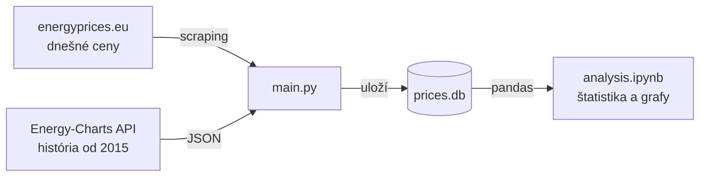
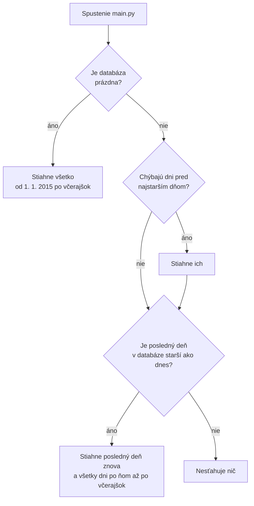

# Ceny elektriny na Slovensku

Projekt, ktorý zbiera hodinové ceny elektriny na Slovensku, ukladá ich do databázy a analyzuje ich.
Cieľom je neskôr ceny aj predpovedať.

Ide o **day-ahead ceny**: cenu na každú hodinu zajtrajška určí burza vždy deň vopred. Sú to
veľkoobchodné ceny bez DPH, distribúcie a ďalších poplatkov, takže nie sú to isté, čo platí domácnosť
na faktúre. Dobre však ukazujú, kedy je elektriny v sieti dosť a kedy je drahá.

Projekt má dve časti:

- **Zber dát** ([`main.py`](main.py)): stiahne dnešné ceny z webu, pri prvom spustení dotiahne celú
  históriu od roku 2015 a pri ďalších spusteniach doplní len dni, ktoré chýbajú.
- **Analýza** ([`analysis.ipynb`](analysis.ipynb)): Jupyter notebook so štatistikou a grafmi, napríklad
  ako sa cena menila počas rokov, v ktorú hodinu je elektrina najlacnejšia alebo ako často je cena záporná.

## Prečo tu nie sú grafy

Historické dáta pochádzajú z API [Energy-Charts](https://energy-charts.info), ktoré ich poskytuje len
na súkromné a interné použitie. Zverejniť sa nesmú ani surové dáta, ani nič, čo z nich vznikne
(grafy, tabuľky, vypočítané čísla). Preto:

- databáza `prices.db` je v [`.gitignore`](.gitignore),
- notebook je v repozitári bez výstupov, grafy sa zobrazia až po jeho spustení,
- zhrnutie na konci notebooku popisuje zistenia len slovne, bez čísel.

Kód je verejný. Kto ho spustí, stiahne si dáta sám pre vlastnú potrebu.

## Ako je to postavené



Oba zdroje majú rovnaké dáta, pôvodne z európskej platformy ENTSO-E. Web ukazuje len dnešok
(a denné priemery za posledných 30 dní), staršie hodinové ceny poskytuje iba API.

### Zber dát

`main.py` pri každom spustení urobí tri veci:

1. **Stiahne dnešné ceny z webu.** Z HTML tabuľky prečíta 24 hodín a vypíše ich do terminálu.
2. **Doplní históriu z API.** Pozrie sa, ktoré dni v databáze chýbajú, a stiahne len tie.
3. **Uloží dnešné ceny do databázy.**

Každý krok je samostatná funkcia (`scrape_today`, `missing_ranges`, `fetch_history`, `save`)
a funkcia `main` ich len zavolá v tomto poradí.

Ktoré dni sa sťahujú z API:



Prvé spustenie trvá dve až tri minúty. Ďalšie spustenia v ten istý deň už z API nesťahujú nič
a po pár vynechaných dňoch stiahnu len tie dni.

Posledný deň sa sťahuje znova zámerne. Ceny z webu sú zaokrúhlené na 3 desatinné miesta, z API
na 5. Keď skript beží každý deň, včerajšie ceny z webu sa tak na druhý deň nahradia presnejšími z API.

Pár vecí, ktoré nie sú na prvý pohľad vidieť:

- **Výpadok webu nezastaví skript.** Keď web nefunguje alebo nie je internet, skript to vypíše
  a históriu z API doplní aj tak. Dnešné ceny sa vtedy uložia pri ďalšom úspešnom spustení.
- **API sa nesmie zahltiť.** Pustí približne jednu požiadavku za 15 sekúnd. Skript preto sťahuje
  po celých rokoch (jedna požiadavka = jeden rok). Keď API odpovie `429 Too Many Requests`,
  počká toľko, koľko server povie v hlavičke `Retry-After`, a skúsi to znova.
- **Žiadne duplikáty v databáze.** Dvojica dátum + hodina je primárny kľúč a zápis cez
  `INSERT OR REPLACE` existujúci riadok prepíše namiesto pridania nového. Skript sa preto dá
  spustiť koľkokrát chceš.
- **Neúplné sťahovanie nenechá diery.** Celá história sa uloží naraz v jednej transakcii. Keď
  sťahovanie spadne, neuloží sa nič a pri ďalšom spustení sa stiahne celé znova.
- **Od októbra 2025 sú ceny po 15 minútach.** API vtedy vracia štyri ceny na hodinu, skript z nich
  spraví hodinový priemer, aby boli všetky dáta v rovnakom tvare.
- **Jednotky.** API vracia €/MWh, skript ich prepočíta na €/kWh, rovnako ako na webe.
- **Čas.** API posiela čas ako unixový timestamp a skript ho prevedie na miestny čas počítača.
  Na Slovensku (SEČ/SELČ) je to správne. Na počítači v inom časovom pásme by sa hodiny posunuli.

### Databáza

Jedna tabuľka v súbore `prices.db` (SQLite, netreba inštalovať žiadny server):

| Tabuľka | Stĺpce |
|---|---|
| `prices` | `date` (text, `2026-10-20`), `hour` (0 – 23), `price` (€/kWh); dvojica `date` + `hour` je primárny kľúč |

### Analýza

Notebook číta dáta priamo z databázy cez `pd.read_sql` a každá sekcia má krátke vysvetlenie,
čo robí a aký príkaz z pandas používa.

| # | Sekcia | Čo ukáže |
|---|---|---|
| 1 | Načítanie dát | `read_sql`, časový index, pomocné stĺpce (rok, mesiac, deň v týždni) |
| 2 | Kontrola dát | `describe()`, chýbajúce dni, najdrahšie a najlacnejšie hodiny |
| 3 | Rozdelenie cien | histogram, priemer vs. medián, smerodajná odchýlka, šikmosť, percentily |
| 4 | Odľahlé hodnoty | boxplot podľa mesiacov, pravidlo IQR, z-skóre |
| 5 | Vývoj 2015 – 2026 | mesačné priemery cez `resample` |
| 6 | Kĺzavé priemery | priemer za 30 a 365 dní, pásmo priemer ± 2 smerodajné odchýlky |
| 7 | Rozklad časového radu | cena = trend + sezónnosť + zvyšok, spočítané ručne v pandas |
| 8 | Priebeh dňa | priemerná cena podľa hodiny vo vybraných rokoch |
| 9 | Pracovný deň vs. víkend | priemerná cena podľa hodiny |
| 10 | Hodina × mesiac | heatmapa |
| 11 | Záporné ceny | počet hodín so zápornou cenou za rok |
| 12 | Kolísanie počas dňa | rozdiel medzi najdrahšou a najlacnejšou hodinou dňa |
| 13 | Regresia a autokorelácia | dnešná cena vs. včerajšia, regresná priamka, R², autokorelácia |

Hlavné zistenia (slovne, presné čísla ukáže notebook po spustení):

- Energetická kríza v rokoch 2021 – 2022 je v dátach jasne vidieť. Ceny potom klesli, ale zostali
  vyššie ako pred krízou.
- Najlacnejšia hodina dňa sa za posledné roky presunula **z noci na obed**, lebo cez deň vyrábajú
  veľa solárne elektrárne. Najdrahšie je stále večer.
- Víkend je lacnejší ako pracovný deň, najviac na obed.
- Hodín so zápornou cenou v posledných rokoch výrazne pribudlo.
- Cena silno súvisí s cenou pred hodinou, pred dňom aj pred týždňom, čo je dobrý základ pre predikciu.

## Spustenie

Potrebuješ [Python](https://www.python.org/downloads/) 3.12 alebo novší a [Git](https://git-scm.com/).
Na notebook odporúčam [VS Code](https://code.visualstudio.com/) s rozšírením Jupyter.

### 1. Stiahni projekt

```bash
git clone https://github.com/Matus1232/Script-for-electricity-prices-with-prediction.git
```

Ďalšie príkazy spúšťaj v priečinku projektu (`cd Script-for-electricity-prices-with-prediction`).

### 2. Nainštaluj knižnice

```bash
pip install -r requirements.txt
```

Presné verzie sú v [`requirements.txt`](requirements.txt):

| Knižnica | Načo je |
|---|---|
| `requests` | sťahovanie webu a volanie API |
| `beautifulsoup4` | čítanie HTML tabuľky z webu |
| `pandas`, `numpy` | práca s dátami a výpočty v notebooku |
| `matplotlib` | grafy |
| `ipykernel` | aby VS Code vedel spúšťať notebook |

### 3. Stiahni dáta

```bash
python main.py
```

Skript vypíše dnešné ceny po hodinách a potom postup sťahovania histórie po rokoch. Na konci
vznikne v priečinku súbor `prices.db`. Aby databáza ostala aktuálna, stačí skript spustiť raz za deň.

### 4. Spusti analýzu

Otvor `analysis.ipynb` vo VS Code, vpravo hore vyber kernel s Pythonom, ktorý má nainštalované
knižnice, a klikni na **Run All**. Ak `prices.db` ešte neexistuje, bunka v sekcii 1 skončí chybou
s upozornením, že treba najprv spustiť `main.py`.

> ⚠️ Pred commitom daj v notebooku **Clear All Outputs**. VS Code ukladá grafy a tabuľky priamo do
> súboru notebooku a tie sa na GitHub dostať nesmú.

## Známe obmedzenia

- **V zdroji chýba pár dní** z rokov 2015 – 2016. V notebooku ich pri kĺzavých priemeroch dopĺňa
  `interpolate()`, inak ostávajú prázdne.
- **Letný čas.** Posledná nedeľa v marci má len 23 hodín. V októbri je hodina 2:00 dvakrát
  a v databáze je z nich priemer.
- **Dnešok je menej presný.** Kým skript nebeží znova na ďalší deň, má dnešok ceny z webu
  zaokrúhlené na 3 desatinné miesta.

## Štruktúra projektu

```
main.py           zber dát: scraping webu, história z API, zápis do databázy
analysis.ipynb    analýza: štatistika a grafy
requirements.txt  knižnice s presnými verziami
.gitignore        dáta, ktoré sa nesmú zverejniť
prices.db         SQLite databáza, vznikne po spustení main.py (nie je v Gite)
```

## Stav projektu

- [x] Scraping dnešných cien z webu
- [x] Databáza SQLite a história od roku 2015 z API
- [x] Analýza: popisná štatistika, časové rady, regresia
- [x] `requirements.txt`
- [x] Upratanie `main.py` do funkcií
- [ ] Predikcia cien na ďalší deň (baseline, lineárna regresia, Random Forest, porovnanie cez MAE)
